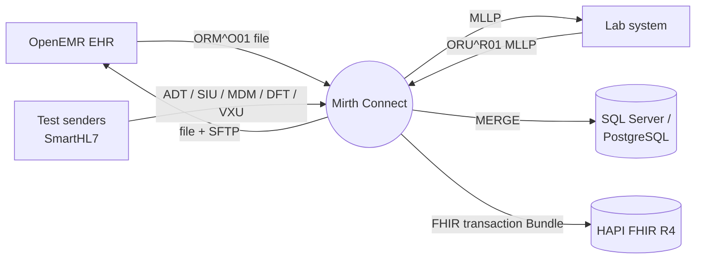

# Healthcare Interoperability Portfolio

Hands-on HL7 v2 and FHIR R4 interfaces built in **Mirth Connect (NextGen Connect)**: real hospital message flows between an EHR (OpenEMR), a lab, SQL databases, an SFTP server and a FHIR server.

Built by **Eugene Afum-Agyei** as part of the Data InterOps program (June 2026 – present), drawing on 8+ years of enterprise API and systems integration work in banking.

**LinkedIn:** [linkedin.com/in/eugene-a-77303645](https://www.linkedin.com/in/eugene-a-77303645/)

> All patients, providers and identifiers in this repository are **synthetic test data**. No real PHI is included.

---

## What's in here

| # | Interface | Messages | Transport | Target | Key techniques |
|---|---|---|---|---|---|
| 1 | **ADT → SQL Server** | ADT^A01, A04, A08, A03 | MLLP | SQL Server | One row per visit with `MERGE`; updates never erase data the message omitted; AL1 allergies in a child table; resends create no duplicates |
| 2 | **ADT file-to-file** | ADT | File reader → file writer | File system | MRN selected from repeating PID.3 by identifier type; SSN stripped from PID.3 and PID.19; MSH receiver rerouted; dynamic output file names; messages without a valid MRN rejected |
| 3 | **SIU scheduling → SQL** | SIU^S12, S14, S15, S26 | MLLP | SQL Server | New appointments inserted; reschedules and cancellations update the same row via `MERGE`, with audit timestamps |
| 4 | **MDM documents → SQL** | MDM^T02 | MLLP | SQL Server | TXA metadata; multi-line OBX report text joined; timestamps converted |
| 5 | **Lab orders: OpenEMR → lab** | ORM^O01 | File reader → MLLP | Lab system | Preprocessor repairs segments split by embedded carriage returns; duplicate DG1 removed; SSN removed; ACK validated |
| 6 | **Lab results: lab → OpenEMR** | ORU^R01 | MLLP → file + SFTP | OpenEMR EHR | Results matched to order (ORC/OBR placer number), patient and provider NPI; filed to the chart with OBX.8 abnormal flags; queue-on-failure verified with an SFTP outage test |
| 7 | **Charges → SQL** | DFT^P03 | MLLP | SQL Server | CPT/HCPCS, NDC and Z-segment revenue code; duplicate prevention on transaction ID; credits linked to the original charge |
| 8 | **Immunizations → registry table** | VXU^V04 (v2.5.1) | MLLP | SQL Server | RXA/RXR/OBX parsing (CVX, MVX, lot, VFC eligibility); add / update / delete via RXA.21 with `MERGE` on ORC.3 and soft deletes |
| 9 | **ADT → FHIR** | ADT^A01, A04 | MLLP → HTTPS | HAPI FHIR R4 | PID → Patient, PV1 → Encounter in one **transaction Bundle**; `urn:uuid` linking; conditional `PUT` on MRN and visit number (idempotent) |
| 10 | **ORM → FHIR** | ORM^O01 | MLLP → HTTPS | HAPI FHIR R4 | Patient + Encounter + **ServiceRequest** (ORC + OBR) with references to both |
| 11 | **ORU → FHIR** | ORU^R01 | MLLP → HTTPS | HAPI FHIR R4 | One **Observation per OBX** (loop), **DiagnosticReport** with `result` links, order updated to `completed`; LOINC, UCUM, reference ranges, interpretation flags |
| 12 | **Lab results with comments and corrections → SQL** ([INC-2071](docs/tickets/INC-2071.md)) | ORU^R01 | MLLP | SQL Server | Walks all segments in order so each NTE attaches to its OBX; one row per result; corrected results (OBX.11 = C) replace the original via filler order + LOINC key |
| 13 | **Patient merge** ([INC-2084](docs/tickets/INC-2084.md)) | ADT^A40 | MLLP | SQL Server | PID.3 survivor / MRG.1 retired; validation before any change; results re-pointed with the original MRN kept for audit; merge log |

Across every channel: **MSH.9 message-type filters** on the source, ACK handling (AA / AE / AR), and errors surfaced in the Message Browser instead of silently dropped.

---

## Architecture



**Environment:** Mirth Connect, OpenEMR, MariaDB and an SFTP server in Docker (`environment/docker-compose.yml`), SQL Server and PostgreSQL, SmartHL7 for sending test messages, Insomnia for FHIR API testing, and the public HAPI FHIR R4 test server.

---

## HL7 v2 → FHIR mapping (interfaces 9–11)

| HL7 v2 | FHIR R4 | Notes |
|---|---|---|
| PID | **Patient** | MRN chosen by PID.3.5 = MR; SSN never sent; M/F → male/female; `yyyyMMdd` → `yyyy-MM-dd` |
| PV1 | **Encounter** | PV1.19 → identifier; PV1.2 I/O/E → IMP/AMB/EMER (v3-ActCode); PV1.44 → `period.start` with timezone |
| ORC + OBR (order) | **ServiceRequest** | ORC.2 → identifier (PLAC); ORC.1 NW → `active`; OBR.4 → LOINC `code`; ORC.9 → `authoredOn`; ORC.12 → `requester` |
| OBR (result) | **DiagnosticReport** | OBR.3 filler number → identifier; OBR.25 → `status`; `result` → each Observation; `basedOn` → the order |
| OBX | **Observation** | OBX.3 → LOINC; OBX.5 + OBX.6 → `valueQuantity` (UCUM); OBX.7 → `referenceRange`; OBX.8 → `interpretation`; OBX.11 → `status` |

Full field-by-field tables: [`docs/hl7-to-fhir-mapping.md`](docs/hl7-to-fhir-mapping.md)

**Design choices**
- **Transaction Bundles:** all resources from one message are saved together or not at all.
- **Conditional `PUT` on business identifiers** (MRN, visit number, order number): resending a message updates the same records instead of creating duplicates, the FHIR equivalent of SQL `MERGE`. Verified: a resend returns `200 OK` with *no changes detected*.
- **`urn:uuid` temporary ids** link resources inside a Bundle before the server assigns real ids.
- **Optional fields are only added when present**, because FHIR rejects empty values.

---

## Repository layout

```
channels/           Exported Mirth channels (XML), credentials removed
transformers/
  hl7/              JavaScript transformers for HL7 → SQL channels
  fhir/             JavaScript transformers for HL7 → FHIR channels
sql/                Table definitions and destination SQL (MERGE)
sample-messages/    Synthetic HL7 test messages, by message type
docs/               Mapping tables and troubleshooting log
environment/        Docker Compose for OpenEMR, MariaDB and SFTP
screenshots/        Message Browser, SQL results and FHIR responses
```

---

## Ticket write-ups

Real-world style incidents worked from report to fix:
- [INC-2071: Lab comments missing and corrected results duplicated](docs/tickets/INC-2071.md)
- [INC-2084: Results filed to a duplicate patient record (ADT^A40)](docs/tickets/INC-2084.md)

---

## Troubleshooting highlights

Real problems found and fixed while building these interfaces (full list in [`docs/troubleshooting-log.md`](docs/troubleshooting-log.md)):

- OpenEMR wrote DG1 segments broken by escaped carriage returns (`\X0d\`); fixed with a preprocessor.
- SQL Server rejected empty strings for `DATETIME2`; fixed with `DateUtil` conversion plus `NULLIF`.
- Resent messages created duplicates; replaced `INSERT` with `MERGE` / conditional upserts.
- A misrouted ORM arrived on the results port; added MSH.9 filters to every source.
- Queued results were missing after an outage; traced to the stopped SFTP container, and confirmed the queue drained on restart.
- Java rejected a raw `|` in the FHIR search URL; fixed by URL-encoding it as `%7C`.
- The public FHIR server's narrative template failed on Observation flags; worked around by sending our own narrative.

---

## Skills demonstrated

**HL7 v2:** ADT (incl. A40 merge), ORM, ORU, SIU, MDM, DFT, VXU, ACK · MSH, EVN, PID, PV1, MRG, ORC, OBR, OBX, NTE, TXA, SCH, AIL, AIP, FT1, DG1, AL1, IN1, GT1, RXA, RXR, Z-segments
**FHIR R4:** Patient, Encounter, ServiceRequest, Observation, DiagnosticReport, Condition, Bundle (transaction), conditional update, search, `$validate`, `$everything`, OperationOutcome
**Integration:** Mirth Connect channels, filters, preprocessors, JavaScript transformers, response handling, queuing · MLLP/TCP, SFTP, HTTPS/REST
**Data:** SQL Server and PostgreSQL `MERGE` / upsert patterns, data validation, PHI minimization
**Code sets:** LOINC, ICD-10-CM, CPT/HCPCS, NDC, CVX, MVX, UCUM, HL7 v2 tables
